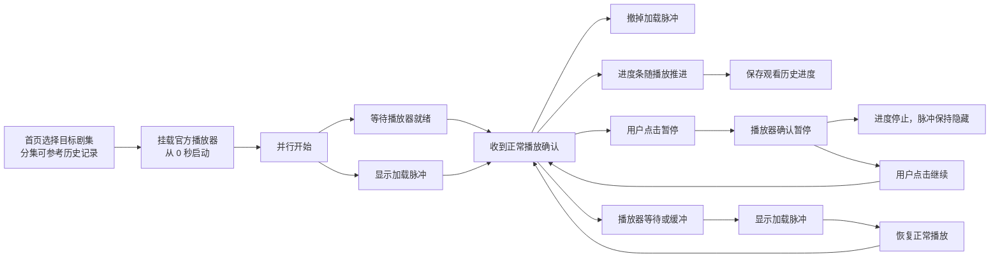

# 播放页状态流程

本文固定 TikTok Minis 播放页的启动、加载提示、播放、暂停和缓冲状态关系。所有播放页相关的新增、删除或修改都必须先对照本流程审查，并取得用户对具体改动方案的明确批准。

## 固定流程
https://www.figma.com/online-whiteboard/create-diagram/f1116481-f7ae-45f3-a320-fd9a7890e4c8?utm_source=chatgpt&utm_content=edit_in_figjam&oai_id=v1%2FnonMulEGOTo4H3A16MicwcL3pkhuYeQPe50S2Qty2QOpItIMkhS7Ju&request_id=0635cd3c-3b9e-497b-a25e-c0758b33a6be

## 状态约束

- 首页可以依据历史记录选择最近观看的分集；进入播放页后无论是否有历史秒数，都从 0 秒播放，不执行历史时间定位。
- 本地历史进度仍在正常播放期间持续记录，用于历史展示和首页选择分集，不作为播放页的 seek 目标。
- 加载脉冲与播放器启动并行显示；所有播放都等待官方播放器确认进入正常播放后再撤掉脉冲。
- 只有确认正常播放后才撤掉加载脉冲。首帧确认、播放器就绪或进度事件单独发生，都不等同于正常播放确认。
- 正常播放期间进度条可以推进，加载脉冲保持隐藏；播放中发生等待或缓冲时显示脉冲，确认恢复正常播放后再撤掉。
- 用户点击暂停后，以播放器确认暂停为准停止播放进度并保持脉冲隐藏。点击继续后等待播放器重新确认正常播放。
- 进度记录仍按当前应用与 Visitor 隔离；不把历史进度作为播放授权或播放页定位依据。

## 改动前校验与批准

1. 先读取本文件和当前相关实现，定位改动影响的状态、事件和界面表现。
2. 按固定流程检查拟议改动，明确说明新增、删除或改变的节点、条件、回调及其对有/无历史进度、暂停和缓冲路径的影响；指出任何偏离及原因。
3. 提交具体改动方案并等待用户明确批准。用户提出问题、报告现象或要求调查，不代表批准代码、测试、样式或配置的增删改。
4. 获批后只实施批准范围。若实现中发现必须扩大范围或改变流程，暂停并重新说明方案、等待批准。
5. 完成后用聚焦验证证明各受影响分支符合本流程；如有平台时序无法在本地验证，清楚标为待设备验收。
